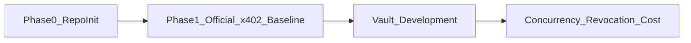

# Architecture

## Components

| Component | Location | Role |
|-----------|----------|------|
| Agent client | `apps/agent-client` | Drives the shared request sequence |
| Merchant API | `apps/merchant-api` | **One** mock Merchant API (not multiple APIs) |
| Shared package | `packages/shared` | Shared types/constants (added later) |
| Vault (later) | `contracts` | On-chain budget ceiling; developed only after Phase 1 baseline settles |

## Payment paths

Both paths use the **same** mock Merchant API, price, network (Base Sepolia), test asset (test USDC), and request sequence:

1. **Path A — Official x402 baseline**
   Phase 1 demonstrates an official x402 Base Sepolia test-USDC payment against the mock Merchant API.

2. **Path B — Experimental Vault-controlled path**
   Starts only after Path A settles successfully. This path must **not** be described as an official x402 Exact EVM implementation unless it is actually implemented as a supported scheme.

## Phase gating

## Safety

No real funds, real customer information, or production credentials. Secrets stay in local `.env` (gitignored).
